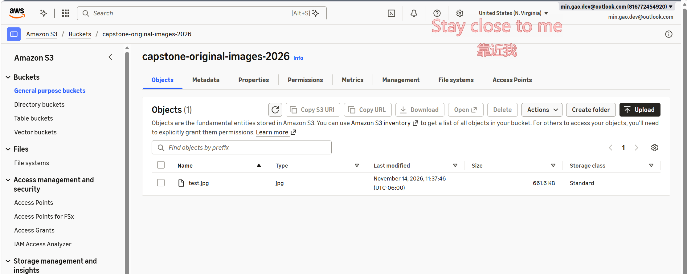
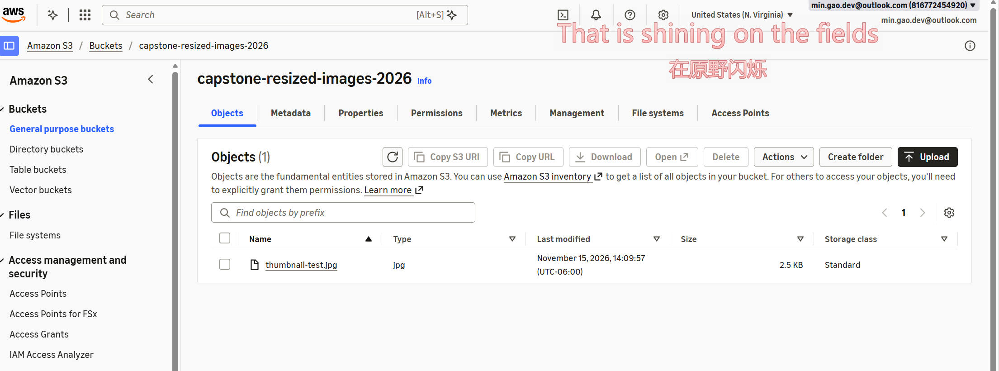
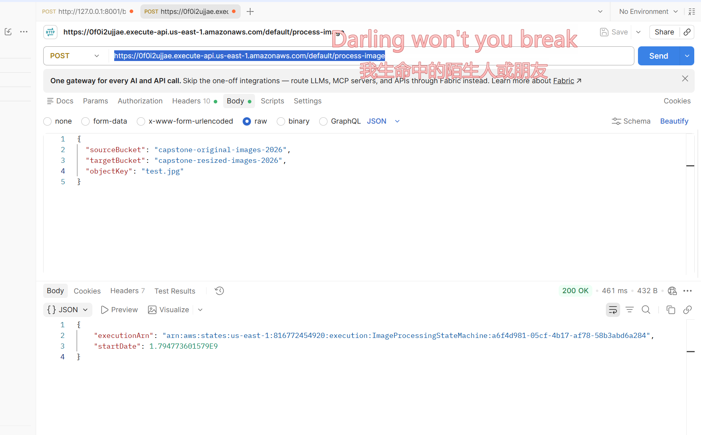
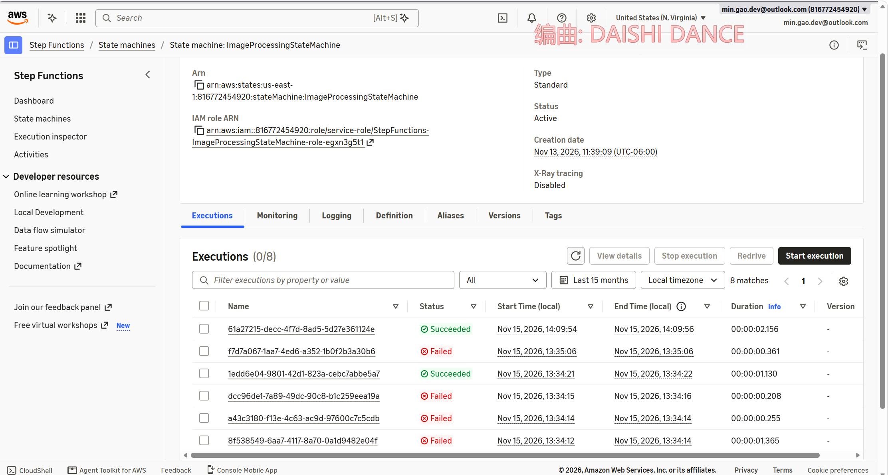
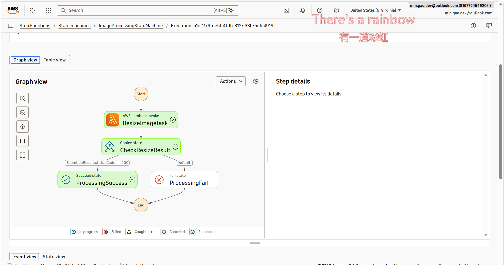
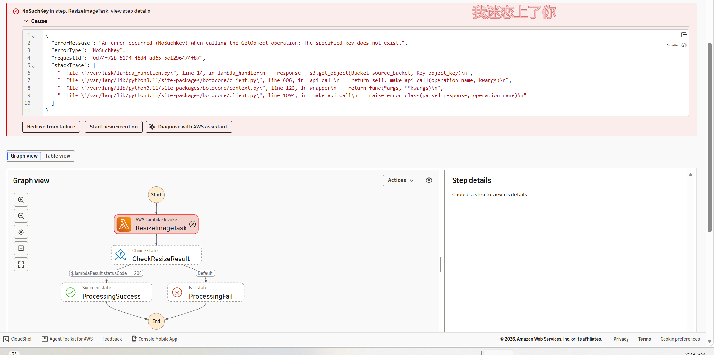

# Serverless Image Processing Pipeline (Capstone Project)

## Project Overview

This project implements a fully serverless, event-driven and API-triggered image processing pipeline built on AWS. When an HTTP POST request hits the API Gateway, it triggers an AWS Step Functions state machine to orchestrate a Lambda function. The Lambda function automatically resizes the original image and stores the resulting thumbnail into a dedicated destination S3 bucket.

---

## High-Level Architecture

```text
+-----------------+      +-----------------+      +--------------------+      +-----------------+
|   API Gateway   |----->| Step Functions  |----->|   Lambda Function  |----->|       S3        |
+-----------------+      +-----------------+      +--------------------+      +-----------------+
         ^
         |
+-----------------+
|   CloudWatch    |
+-----------------+

```

- **API Gateway (REST API)**: Provides a public REST endpoint to externally trigger the workflow.
- **AWS Step Functions**: Orchestrates the image processing workflow, handling execution flow, success states, and error handling.
- **AWS Lambda**: Executes the image resizing logic (utilizing the `Pillow` library).
- **Amazon S3**: Stores original raw images and processed thumbnail images.
- **Amazon CloudWatch**: Monitors execution logs and metrics.

---

## Repository Structure

```text
├── lambda/
│   └── lambda_function.py        # Python source code for image resizing (Pillow)
├── images/
├── .gitignore
├── LICENSE
├── statemachine/
│   └── definition.json
└── README.md                     # Project documentation

```

---

## Prerequisites & Infrastructure Setup

1. **AWS Account & Region**: Set up in `us-east-1`.
2. **Amazon S3 Buckets**:

- Original Images Bucket: `capstone-original-images-2026`
- Resized Images Bucket: `capstone-resized-images-2026`

3. **AWS Lambda**:

- Runtime: Python 3.11
- Dependencies: Packaged with `Pillow` via Lambda Layer or deployment package.

4. **AWS Step Functions**:

- State Machine Name: `ImageProcessingStateMachine`
- ARN: `arn:aws:states:us-east-1:816772454920:stateMachine:ImageProcessingStateMachine`

5. **API Gateway & IAM Security**:

- Created a dedicated IAM Execution Role (`ApiGatewayToStepFunctionsRole`) with `AWSStepFunctionsFullAccess` and trust relationship configured for `apigateway.amazonaws.com`.
- Configured VTL Mapping Templates on the API Gateway integration request to pass the `stateMachineArn` and escaped input body.

---

## Deployment & Testing Instructions

### 1. Invoke URL

The API has been successfully deployed to the `default` stage. You can trigger it using the following endpoint:

- **Endpoint**: `[https://0f0i2ujjae.execute-api.us-east-1.amazonaws.com/default/process-image](https://0f0i2ujjae.execute-api.us-east-1.amazonaws.com/default/process-image)`
- **Method**: `POST`

### 2. Test Payload (JSON)

Send a `POST` request using tools like Postman with the following JSON body:

```json
{
  "sourceBucket": "capstone-original-images-2026",
  "targetBucket": "capstone-resized-images-2026",
  "objectKey": "test.jpg"
}
```

### 3. Verification

- **API Gateway**: Returns a `200 OK` response along with the Step Functions execution ARN.
- **Step Functions**: Check the console to verify that the execution status shows green (**Succeeded**).
- **Amazon S3**: Check the target bucket (`capstone-resized-images-2026`) to confirm the resized image has been successfully generated and stored.







